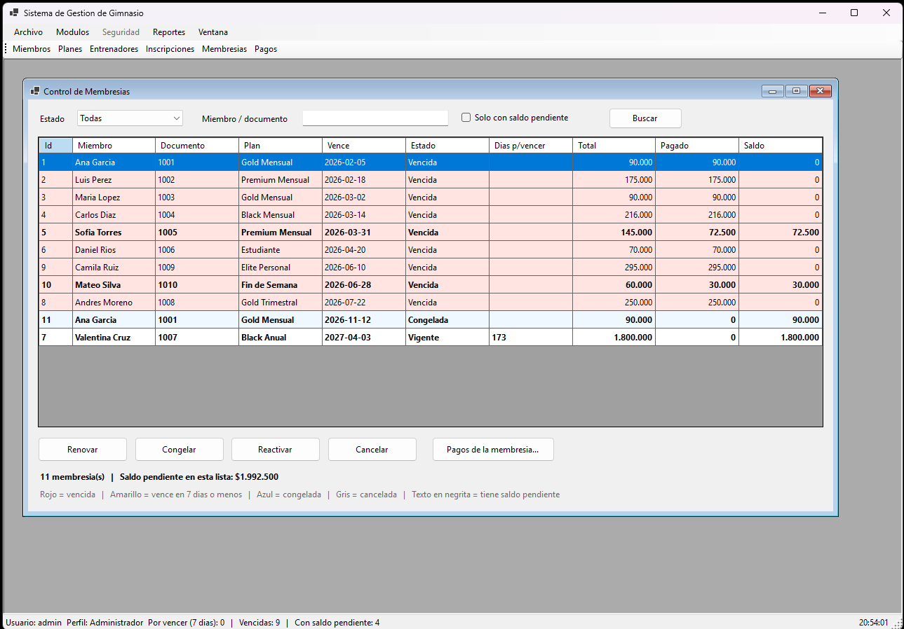
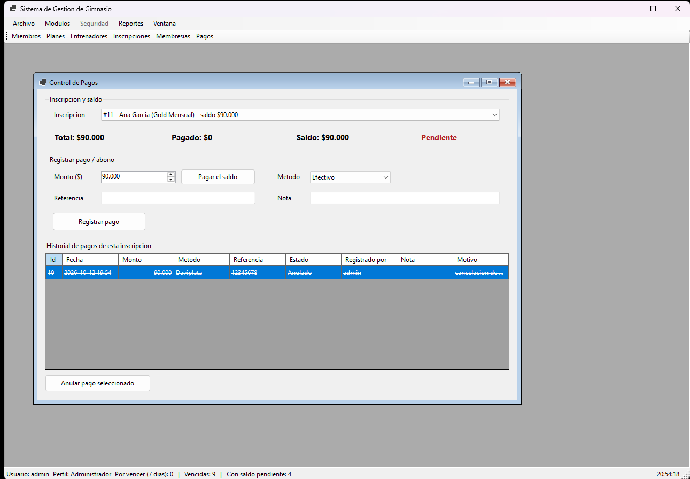
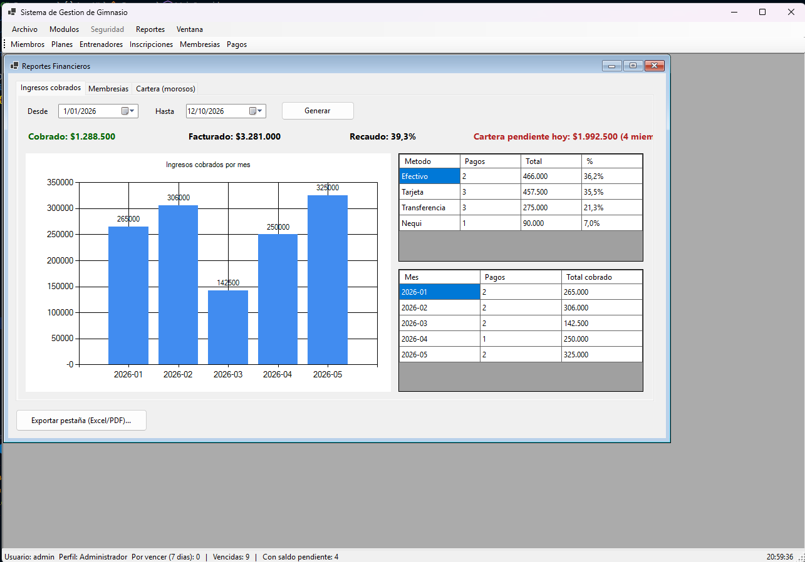

#  Gym Management System

Aplicación de escritorio para administrar un gimnasio: **socios, planes, entrenadores, membresías, pagos y reportes**, con seguridad por roles y permisos, auditoría y arquitectura en N capas.


> Proyecto académico (Politécnico Internacional) evolucionado a una aplicación de nivel empresarial: control de acceso configurable, pagos con abonos, ciclo de vida de membresías, reportes financieros y trazabilidad de acciones.


## Capturas

| Login | Membresías |
| [Login](docs/screenshots/login.png) |  |

| Pagos | Reportes financieros |
|  |  |


##  Funcionalidades

**Gestión del negocio**
- **Miembros, planes y entrenadores**: altas, bajas, ediciones y búsqueda, con validación de datos (nombre, documento, teléfono, correo) y detección de duplicados.
- **Inscripciones** con detalle por conceptos, cálculo automático del total y opción de *deshacer* la última eliminación.
- **Importación de miembros desde CSV** con vista previa y reporte de filas inválidas (hay un archivo de ejemplo en `samples/`).

**Membresías**
- Estados: *Vigente, Vencida, Congelada, Cancelada* (garantizados con restricciones `CHECK` en la base de datos).
- **Renovar** (sin perder días si aún está vigente), **congelar y reactivar** (el vencimiento se extiende por los días congelada) y **cancelar** con motivo.
- Alertas de vencimiento en la barra de estado y semáforo de colores en el listado.

**Pagos**
- Pagos y **abonos parciales** con 5 métodos (efectivo, tarjeta, transferencia, Nequi, Daviplata) y número de referencia.
- Saldo en tiempo real; un pago **nunca supera el saldo** (verificado dentro de una transacción con bloqueo, así dos cajeros no pagan el mismo saldo a la vez).
- **Anulación con motivo**: el pago no se borra, queda en el historial.

**Reportes** (exportables a Excel y PDF)
- Miembros por plan, inscripciones por mes e ingresos por rango, con gráficos.
- Financieros: ingresos **cobrados** vs **facturados**, % de recaudo, cartera pendiente, ingresos por mes y por método de pago, membresías por vencer y morosos.

**Seguridad y trazabilidad**
- Contraseñas con **PBKDF2-SHA256** (salt aleatorio, 100 000 iteraciones); migración automática de hashes antiguos en el primer login.
- Política de contraseñas, **bloqueo de cuenta** tras intentos fallidos y recuperación mediante pregunta de seguridad.
- **Roles y permisos editables** desde la aplicación (relación muchos‑a‑muchos en la base de datos); los permisos se exigen también en la capa de negocio, no solo ocultando botones.
- **Auditoría** de acciones (quién hizo qué y cuándo) y **log de errores** con código de soporte para el usuario.

##  Arquitectura

```
┌────────────┐   ┌────────────────────┐   ┌────────────────┐   ┌────────────┐
│  App.UI    │──▶│      App.BLL       │──▶│    App.DAL     │──▶│ SQL Server │
│ WinForms   │   │ reglas de negocio, │   │ ADO.NET con    │   │ tablas,    │
│ (pantallas)│   │ permisos, auditoría│   │ consultas      │   │ vistas,    │
│            │   │ validaciones       │   │ parametrizadas │   │ índices    │
└────────────┘   └────────────────────┘   └────────────────┘   └────────────┘
```

Cada capa solo conoce a la inmediatamente inferior. Más detalle y decisiones de diseño en [`docs/ARQUITECTURA.md`](docs/ARQUITECTURA.md); el modelo de datos en [`docs/BASE_DE_DATOS.md`](docs/BASE_DE_DATOS.md).

## Tecnologías

C# · .NET 10 · Windows Forms · ADO.NET (`Microsoft.Data.SqlClient`) · SQL Server · ClosedXML (Excel) · PdfSharp (PDF) · System.Windows.Forms.DataVisualization (gráficos)

##  Requisitos

| Requisito | Detalle |
|---|---|
| Sistema operativo | Windows 10/11 (Windows Forms) |
| SDK | [.NET 10 SDK](https://dotnet.microsoft.com/download) |
| IDE (opcional) | Visual Studio 2026 (necesario para apuntar a .NET 10 desde VS) o la CLI de `dotnet` |
| Base de datos | SQL Server 2016 SP1+ (Express, Developer, LocalDB o Docker) |
| Herramienta SQL | SQL Server Management Studio (SSMS) o VS Code con la extensión *SQL Server (mssql)* |

##  Instalación

### 1. Clonar

```bash
git clone https://github.com/EstebanEdz/gym-management-system.git
cd gym-management-system
```

### 2. Crear la base de datos

Ejecuta **en este orden** (SSMS → *File → Open → File* → `F5`):

1. [`Database/database.sql`](Database/database.sql): crea `GymDB`, tablas y datos de demostración.
2. [`Database/mejoras_v9.sql`](Database/mejoras_v9.sql): permisos, pagos, auditoría, índices y vistas. Es idempotente (se puede repetir sin perder datos).

>  `database.sql` **borra y recrea** las tablas. Úsalo solo en una instalación nueva; si ya tienes datos, ejecuta únicamente `mejoras_v9.sql`.

### 3. Configurar la conexión

Edita `App.UI/App.config` y ajusta `Server` a tu instancia:

```xml
<add name="GymDbConnection"
     connectionString="Server=localhost;Database=GymDB;Trusted_Connection=True;TrustServerCertificate=True;" />
```

| Tu SQL Server | `Server=` |
|---|---|
| Instancia por defecto | `localhost` |
| SQL Server Express | `.\SQLEXPRESS` |
| LocalDB | `(localdb)\MSSQLLocalDB` |

**¿Autenticación SQL (usuario/contraseña)?** No la escribas en el repo. Define la variable de entorno `GYM_DB_CONNECTION` (tiene prioridad sobre `App.config`):

```powershell
$env:GYM_DB_CONNECTION = "Server=localhost;Database=GymDB;User Id=gym_user;Password=<tu-clave>;TrustServerCertificate=True;"
```

### 4. Ejecutar

```bash
dotnet run --project App.UI
```

o abre `GimnasioApp.sln` en Visual Studio, establece **App.UI** como proyecto de inicio y pulsa `F5`.

### Usuarios de demostración

| Usuario | Contraseña | Perfil |
|---|---|---|
| `admin` | `admin123` | Administrador |
| `operador1` | `oper123` | Operador |
| `consulta1` | `consulta123` | Consulta |

>  Son credenciales **solo para pruebas**. Cámbialas antes de usar la aplicación con datos reales (menú *Archivo → Cambiar mi contraseña*).

##  Roles y permisos

La matriz inicial se puede modificar desde **Seguridad → Permisos por perfil**:

| Permiso | Administrador | Operador | Consulta |
|---|:--:|:--:|:--:|
| Miembros, planes, entrenadores, inscripciones (ver/editar) | 
| Membresías (ver y gestionar) | 
| Pagos: ver y registrar |
| Pagos: anular | 
| Reportes básicos | 
| Reportes financieros | 
| Usuarios, permisos y auditoría | 

##  Estructura del repositorio

```
├── App.UI/            Presentación (WinForms): formularios y diálogos
├── App.BLL/           Lógica de negocio: servicios, validaciones, seguridad, entidades
├── App.DAL/           Acceso a datos: consultas SQL parametrizadas
├── Database/
│   ├── database.sql         Esquema base + datos de demostración
│   ├── mejoras_v9.sql       Migración idempotente (permisos, pagos, auditoría, vistas)
│   └── consultas_demo.sql   13 consultas comentadas (JOIN, HAVING, CTE, LAG, RANK…)
├── docs/              Arquitectura y modelo de datos
├── samples/           CSV de ejemplo para importar miembros
└── GimnasioApp.sln
```

##  Roadmap

- [ ] Pruebas unitarias de la capa de negocio (xUnit)
- [ ] Inyección de dependencias y repositorios como interfaces
- [ ] Migraciones versionadas (DbUp / EF Core Migrations)
- [ ] Recuperación de contraseña por correo
- [ ] API REST para exponer la capa de negocio (web/móvil)

##  Contribuir

Los *issues* y *pull requests* son bienvenidos. Mantén la regla de capas (la UI nunca toca SQL) y usa siempre consultas parametrizadas.

##  Licencia

Distribuido bajo licencia MIT. Consulta [`LICENSE`](LICENSE).

##  Autor

**Esteban Pedraza Alape.**: Desarrollo de software y aplicaciones móviles, Politécnico Internacional (Bogotá, Colombia).
