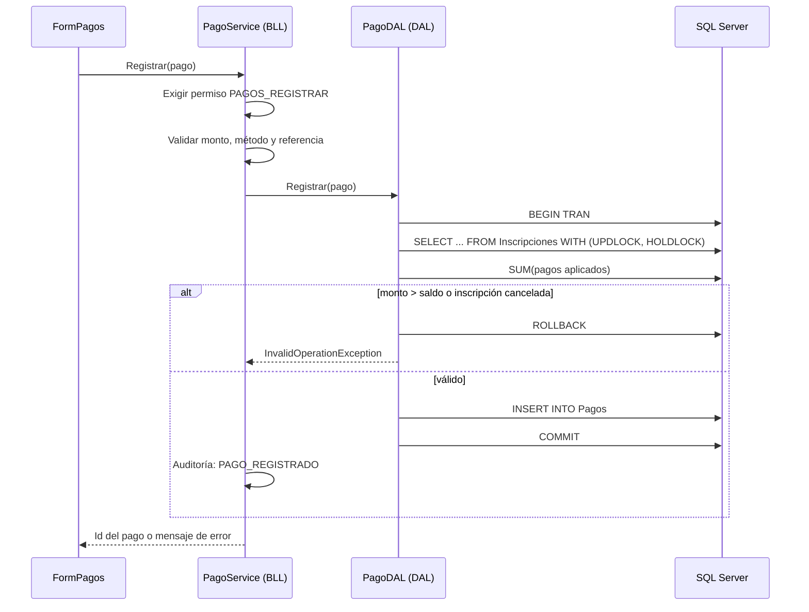

# Arquitectura y decisiones de diseño

## Capas

```
App.UI  ──▶  App.BLL  ──▶  App.DAL  ──▶  SQL Server
```

| Capa | Responsabilidad | Reglas |
|---|---|---|
| **App.UI** (WinForms) | Pantallas, eventos y presentación de mensajes. | Nunca contiene SQL ni reglas de negocio. Solo llama a servicios de la BLL. |
| **App.BLL** | Servicios (`PagoService`, `MembresiaService`, `UsuarioService`…), validaciones, permisos, auditoría, entidades. | No conoce controles de WinForms. Lanza excepciones con mensajes entendibles para reglas de negocio. |
| **App.DAL** | Consultas SQL con ADO.NET (`Microsoft.Data.SqlClient`). | Único lugar con `SqlConnection`/`SqlCommand`. **Siempre parámetros** (`@p`), nunca concatenación de texto. |

`DbHelper` (DAL) encapsula el patrón abrir conexión → ejecutar → cerrar; los DAL más antiguos conservan su estilo original.

## Flujo de ejemplo: registrar un pago



## Seguridad

- **Contraseñas**: PBKDF2-SHA256, salt aleatorio de 16 bytes, 100 000 iteraciones, formato `PBKDF2$iteraciones$salt$hash`. La verificación usa comparación en tiempo constante (`CryptographicOperations.FixedTimeEquals`). Los hashes SHA256 heredados se aceptan y se reescriben al primer inicio de sesión correcto.
- **Política**: mínimo 8 caracteres con letras y números.
- **Bloqueo de cuenta**: tras `IntentosParaBloqueo` fallos acumulados se bloquea `MinutosBloqueo` minutos. El contador y la hora de bloqueo viven en la base de datos (se calculan con la hora del servidor).
- **Autorización**: los permisos del perfil se cargan en `SesionActual` al iniciar sesión. La UI habilita o esconde menús, **y además cada servicio llama a `SesionActual.Exigir(...)`**: ocultar un botón no es una barrera de seguridad.
- **Reglas anti‑bloqueo del sistema**: siempre debe quedar un administrador activo y el perfil Administrador conserva los permisos de administrar usuarios y permisos.
- **SQL Injection**: todas las consultas son parametrizadas.
- **Secretos**: la cadena de conexión usa autenticación de Windows por defecto; para autenticación SQL se usa la variable de entorno `GYM_DB_CONNECTION`, nunca el repositorio.

## Manejo de errores

| Tipo de error | Qué ve el usuario | Qué se registra |
|---|---|---|
| Regla de negocio (`InvalidOperationException`, validaciones, permisos) | El mensaje tal cual | Nada (es un caso esperado) |
| Error de SQL Server | Mensaje traducido por `ErrorTranslator` (duplicado, FK, conexión, timeout…) + código de soporte | `LogErrores` y `Logs/errores-AAAAMMDD.log` |
| Error inesperado | "Ocurrió un error inesperado" + código de soporte | Igual que el anterior, con *stack trace* |

`Program.cs` instala un manejador global (`Application.ThreadException` y `AppDomain.UnhandledException`) para que ningún error no controlado cierre la aplicación sin dejar rastro.

## Auditoría

`AuditoriaService.Registrar(...)` guarda usuario, acción, entidad, id y detalle en la tabla `Auditoria` **después** de que la operación principal tuvo éxito. Si la auditoría falla, el error se registra pero la operación del usuario no se revierte.

## Decisiones y alternativas consideradas

| Decisión | Motivo | Alternativa |
|---|---|---|
| Permisos en base de datos | El administrador puede cambiarlos sin recompilar | Roles fijos en código |
| Bloqueo `UPDLOCK, HOLDLOCK` al pagar | Evita sobrepagos por concurrencia | Restricción por *trigger* o reintentos optimistas |
| Anular pagos en vez de borrarlos | Trazabilidad contable | `DELETE` físico |
| Vistas `vw_SaldoInscripcion` y `vw_Membresia` | La lógica de saldo/estado real vive en un solo lugar | Calcular en C# en cada pantalla |
| ADO.NET puro | Control total del SQL y objetivo didáctico | Dapper o EF Core |

## Limitaciones conocidas

- Aplicación de escritorio de una sola base de datos, sin API ni multi‑sucursal.
- Servicios instanciados con `new` (sin inyección de dependencias), lo que dificulta las pruebas unitarias.
- Algunos formularios antiguos conservan `MessageBox` propios; los errores no controlados los captura el manejador global.
- La recuperación de contraseña usa pregunta de seguridad, no correo electrónico.
- No hay pruebas automatizadas en el repositorio todavía (ver *Roadmap* en el README).
