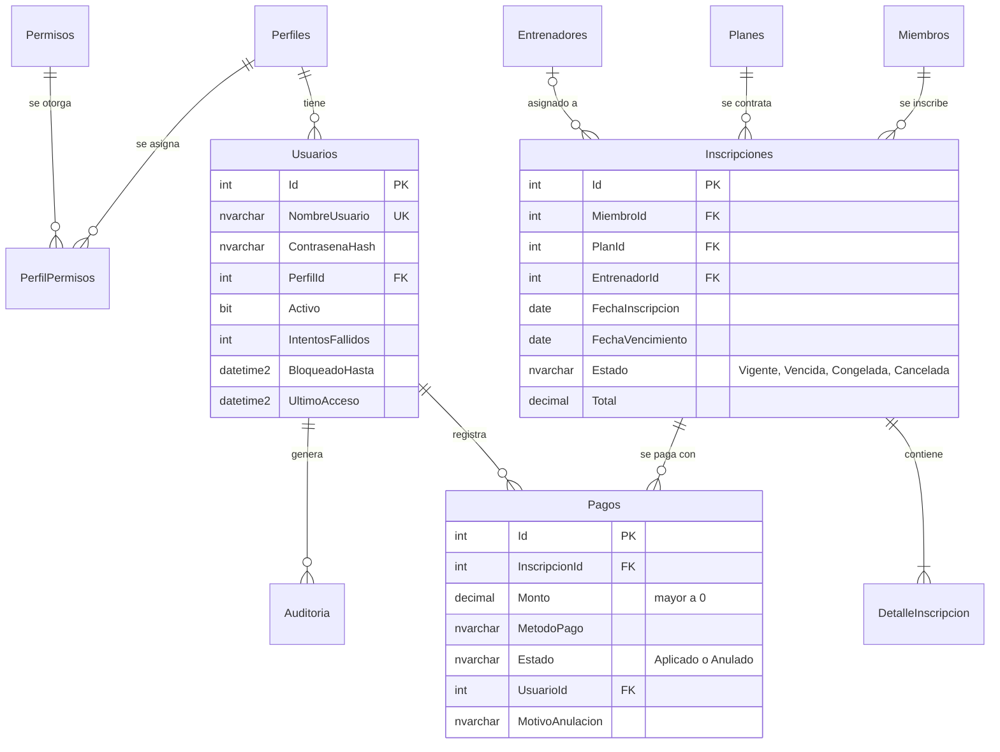

# Modelo de datos

Base de datos `GymDB` (SQL Server). Convención de nombres para las restricciones: `pk_` clave primaria, `fk_` clave foránea, `ck_` `CHECK`, `uq_` `UNIQUE`, `df_` valor por defecto.

## Diagrama entidad‑relación

## Tablas

| Tabla | Descripción |
|---|---|
| `Perfiles`, `Usuarios` | Cuentas de acceso y su perfil. Incluye contador de intentos, bloqueo y último acceso. |
| `Permisos`, `PerfilPermisos` | Catálogo de permisos y tabla puente (relación muchos‑a‑muchos con `Perfiles`). |
| `Miembros`, `Entrenadores`, `Planes` | Catálogos del gimnasio. |
| `Inscripciones`, `DetalleInscripcion` | Contrato de un miembro con un plan y sus conceptos (`Subtotal` es una columna calculada y persistida). |
| `Pagos` | Abonos y pagos. Un pago anulado conserva fecha y motivo. |
| `Auditoria`, `LogErrores` | Trazabilidad de acciones y errores inesperados. |

## Restricciones relevantes

- `ck_Inscripciones_Estado`: solo `Vigente`, `Vencida`, `Congelada`, `Cancelada`.
- `ck_Inscripciones_Fechas`: el vencimiento no puede ser anterior a la inscripción.
- `ck_Pagos_Monto` (`Monto > 0`), `ck_Pagos_Metodo`, `ck_Pagos_Estado`.
- `ck_Pagos_Anulacion`: un pago anulado **debe** tener motivo.
- `fk_Pagos_Inscripciones` sin cascada: una inscripción con pagos no se puede borrar.
- `DetalleInscripcion` → `Inscripciones` con `ON DELETE CASCADE`.

## Índices

| Índice | Para qué sirve |
|---|---|
| `ix_Inscripciones_Miembro` | Historial de inscripciones por miembro |
| `ix_Inscripciones_Estado_Vencimiento` (`INCLUDE` miembro, plan, total) | Listados por estado y alertas de vencimiento |
| `ix_Pagos_Inscripcion` (`INCLUDE` monto, estado, fecha) | Cálculo de saldos sin volver a la tabla (*covering index*) |
| `ix_Pagos_FechaPago` | Reportes de ingresos por rango de fechas |
| `ix_Auditoria_Fecha` | Consulta de la bitácora por fecha |

## Vistas

| Vista | Contenido |
|---|---|
| `vw_SaldoInscripcion` | Total, pagado (solo pagos *Aplicado*) y saldo por inscripción |
| `vw_Membresia` | Membresía con miembro, plan, entrenador, **estado real** (una *Vigente* ya vencida cuenta como *Vencida*), días para vencer y saldo |

## Scripts

| Script | Uso |
|---|---|
| `Database/database.sql` | Instalación **desde cero**. Borra y recrea las tablas y carga datos de demostración. |
| `Database/mejoras_v9.sql` | Migración **idempotente** y no destructiva: permisos, pagos, auditoría, índices, vistas y pagos de ejemplo. |
| `Database/consultas_demo.sql` | 13 consultas comentadas: `JOIN`, `LEFT JOIN`, `GROUP BY/HAVING`, subconsultas, CTE, `LAG`, `RANK`, `SUM() OVER`. |

## Datos de demostración

Los datos de `database.sql` y `mejoras_v9.sql` son ficticios (correos en `example.com`). Los usuarios `admin`, `operador1` y `consulta1` tienen contraseñas públicas de prueba: **cámbialas** si despliegas la aplicación fuera de un entorno de pruebas.
